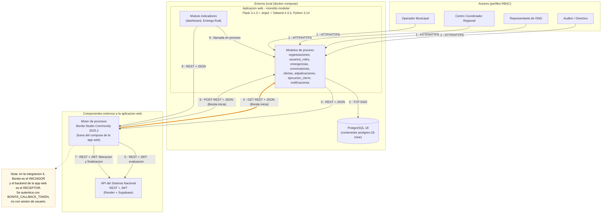
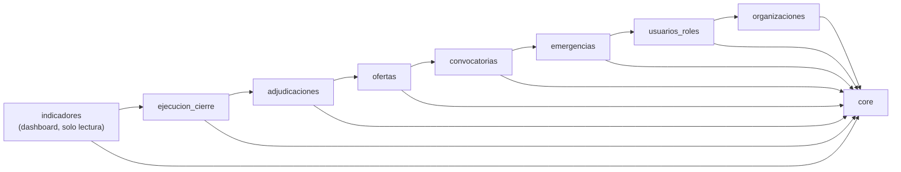

# Arquitectura de componentes

Este documento es la fuente de verdad sobre los componentes del sistema RescueSync, sus
integraciones y la organización interna de la aplicación web. Se mantiene como texto versionado
en Markdown con diagramas Mermaid, de modo que se renderiza directamente en GitHub y puede
capturarse como imagen para los entregables en PDF de la cátedra.

RescueSync es el sistema de coordinación de ayuda humanitaria desarrollado para la materia
Desarrollo de Software en Sistemas Distribuidos (Curso 2026). Articula una aplicación web propia
con un motor de procesos (Bonita) y un servicio externo en la nube (la API del Sistema Nacional,
repositorio `RescueSync-API-Sistema-Nacional`), sobre el proceso modelado en BPMN en la
Entrega 1. **La aplicación web nunca llama a la API del Sistema Nacional:** todas esas llamadas
las hace Bonita, desde sus tareas de servicio.

## 1. Vista general de componentes

El diagrama siguiente distingue tres zonas: los actores que operan el sistema, el entorno local
que el equipo levanta con `docker compose` —donde vive la aplicación web junto a su base de
datos— y los componentes externos, que quedan fuera del `docker-compose.yml` de la aplicación web.

El dashboard de indicadores **no es una aplicación aparte**: es un módulo más dentro de la misma
aplicación web Flask (`indicadores`), que se completa en la entrega final. Aparece identificado
por separado en el diagrama porque es uno de los cinco componentes del sistema que la cátedra
pide distinguir, pero comparte proceso, despliegue y base de datos con el resto de la aplicación
web.



La flecha resaltada en color y grosor mayor es la integración **#4**: Bonita inicia la llamada y
la app web la recibe. Es la integración destacada por la cátedra y se desarrolla en la sección 3.
La **#6** tiene la misma dirección (Bonita le devuelve a la web el resultado de la evaluación).

### 1.1 Componentes, tecnología y responsabilidad

| Componente | Tecnología | Responsabilidad |
|---|---|---|
| Aplicación web (front + back) | Flask 3.1.3 + Jinja2 + Tailwind CSS 4.3.3, sobre Python 3.14 | Interfaces por rol, gestión de emergencias, lotes, convocatorias, ofertas y adjudicación; expone a Bonita las ofertas consolidadas y recibe de Bonita el resultado de la evaluación |
| Base de datos local | PostgreSQL 18 en contenedor (`postgres:18-trixie`) | Persistencia del dominio local: usuarios, organizaciones e inventarios, emergencias, lotes, convocatorias, ofertas y sus versiones, tareas de ejecución y notificaciones. Claves UUID ([ADR-011](../adr/ADR-011-claves-uuid.md)) |
| Motor de procesos | Bonita Studio Community 2025.2 (proceso `RescueSync-1.0`) | Orquesta el ciclo de vida de la emergencia, administra la ventana temporal de ofertas (Timer Event), los caminos alternativos de cobertura y todas las llamadas a la API del Sistema Nacional |
| API del Sistema Nacional | Flask + PostgreSQL con JWT, en Render (plan Free) con la base en Supabase | Padrón y habilitación de ONGs; evalúa la competencia de cada aporte, compromete los recursos no consumibles aceptados con bloqueo de filas, y los libera al reiniciar, al descartar una ONG o al finalizar la emergencia |
| Dashboard de indicadores | Módulo `indicadores` dentro de la misma aplicación web Flask; gráficos y exportación (Entrega final) | Reportes y métricas combinando datos propios con tiempos de etapa extraídos de la API de Bonita |

Los cuatro actores del diagrama —Operador Municipal, Centro Coordinador Regional, Representante
de ONG y Auditor/Directivo— provienen del modelo BPMN aprobado en la Entrega 1 y son los cuatro
perfiles de control de acceso basado en roles (RBAC) que exige el enunciado de la materia. Cada
uno ve un subconjunto distinto de pantallas y acciones dentro de la misma aplicación web; no
existen aplicaciones separadas por rol.

## 2. Integraciones entre componentes

La tabla siguiente enumera las nueve integraciones del sistema, quién las inicia, quién las
recibe, el protocolo empleado, su propósito de negocio y el momento en que ocurren. Los ids que
viajan entre los tres sistemas son UUID ([ADR-011](../adr/ADR-011-claves-uuid.md)).

| # | Iniciador | Receptor | Protocolo | Propósito | Momento |
|---|---|---|---|---|---|
| 1 | Navegador del usuario | Aplicación web | HTTP/HTTPS, HTML | Operar cada etapa del proceso según el rol asignado | Continuo |
| 2 | Aplicación web | PostgreSQL local | TCP 5432 (SQLAlchemy / psycopg) | Persistir y consultar el dominio local | Continuo |
| 3 | Aplicación web | Bonita | HTTP REST + JSON (Bonita REST API, con sesión) | Instanciar el proceso al registrar una emergencia, setear variables de proceso, listar y ejecutar tareas humanas (publicar la convocatoria, decidir ante cobertura insuficiente, seleccionar ofertas, finalizar tareas) | Alta de emergencia y avance del flujo |
| **4** | **Bonita** | **Aplicación web (backend)** | **HTTP GET REST + JSON** | **Solicitar el listado consolidado de ofertas de la convocatoria al vencer el temporizador de la ventana de ofertas** | **Vencimiento de la ventana de ofertas** |
| 5 | Bonita | API del Sistema Nacional | HTTPS REST + JWT | Evaluar la competencia de cada aporte (`POST /ofertas/evaluacion`); la API compromete los no consumibles aceptados | Inmediatamente después de obtener las ofertas consolidadas (integración 4) |
| 6 | Bonita | Aplicación web (backend) | HTTP POST REST + JSON | Devolverle a la web la evaluación (`POST /ofertas/evaluaciones`) para que registre cada aporte y calcule la cobertura | Inmediatamente después de la integración 5 |
| 7 | Bonita | API del Sistema Nacional | HTTPS REST + JWT | Liberar recursos: toda la emergencia al reiniciar la convocatoria, cada ONG no seleccionada al confirmar la selección, y la finalización de la emergencia al terminar la ejecución | Reinicio, selección de ofertas y fin de la ejecución |
| 8 | Módulo `indicadores` (dentro de la app web) | Capa de servicios de los módulos de proceso y PostgreSQL local | Llamada en proceso (Python) sobre la capa `servicios`, y SQLAlchemy contra la base local | Obtener métricas propias: suministros movilizados, porcentaje de consorcios, proyectos finalizados | Bajo demanda |
| 9 | Aplicación web (módulo `indicadores`) | Bonita | HTTP REST + JSON | Obtener tiempos promedio por etapa del proceso para combinarlos con las métricas propias | Bajo demanda |

### Explicación de cada integración

**1. Navegador → Aplicación web.** Es el canal estándar de uso del sistema: cada perfil RBAC
navega las pantallas server-side renderizadas con Jinja2 y envía formularios HTML. No hay una
SPA ni una API pública consumida por un cliente JavaScript separado; el propio servidor Flask
devuelve HTML ya armado.

**2. Aplicación web → PostgreSQL local.** Toda lectura y escritura del dominio propio (usuarios,
emergencias, lotes, convocatorias, ofertas, adjudicaciones, bitácora) pasa por SQLAlchemy sobre
el driver psycopg, contra el contenedor de PostgreSQL 18 levantado en el mismo `docker compose`
que la aplicación.

**3. Aplicación web → Bonita.** Cuando un Operador Municipal da de alta una emergencia, el
backend abre sesión contra la REST API de Bonita, instancia el proceso BPMN correspondiente y
setea las variables de proceso iniciales (identificador de la emergencia, nivel de gravedad,
ubicación, etc.). A medida que el flujo avanza, la aplicación web también consulta y completa
tareas humanas asignadas a los distintos roles a través de esta misma API.

Cuando la cobertura de una convocatoria es insuficiente, la decisión del Centro Coordinador
("Reiniciar convocatoria" o "Enviar ofertas igualmente") completa la tarea "Decidir accion ante
cobertura insuficiente" con `decisionCoberturaInput` = `reiniciar` o `continuar`. Se envía a
Bonita **antes** de guardarla: si el motor no la recibe, no se guarda nada y el coordinador puede
reintentar, en lugar de dejar el caso trabado en esa tarea. Una emergencia sin caso en Bonita (el
motor estaba caído cuando se creó) no tiene tarea que completar: la decisión se guarda igual y se
registra el evento `bonita_decision_sin_caso`.

La selección de ofertas del municipio (tarea "Seleccionar ofertas", con `adjudicacionIdInput`,
`compromisosInput` y `ongsNoSeleccionadasInput`) y la finalización de la última ONG de una
emergencia (tarea "Esperar finalizacion de tareas") siguen la misma regla: se envían a Bonita
**antes** de guardarse. Si el motor no las recibe, la selección no se guarda o la actividad sigue
en ejecución, y se registran `bonita_seleccion_no_comunicada` o
`bonita_finalizacion_no_comunicada`. Sin caso en Bonita siguen su curso local, con
`bonita_seleccion_sin_caso` o `bonita_finalizacion_sin_caso`.

Cuando Bonita rechaza una tarea con un 4xx y explica por qué (las `explanations` de una violación
de contrato, que son los mensajes de error de las restricciones del proceso), el motivo viaja en
`detalle.motivo` del error, se muestra en el aviso y queda en el evento `bonita_rechazo`.

**4. Bonita → Aplicación web (backend).** Esta es la integración inversa del sistema y la única
en la que Bonita actúa como cliente HTTP de la aplicación web. Se detalla en la sección 3.

**5. Bonita → API del Sistema Nacional.** Con el listado consolidado de ofertas (integración 4),
la tarea de servicio *Enviar ofertas a Sistema Nacional* arma el cuerpo de la evaluación
(`emergencia_id`, `nivel_gravedad` y `ofertas`, sin los campos propios de la web) y llama a
`POST /ofertas/evaluacion`. La API clasifica cada aporte como `principal`, `apoyo` o `rechazada`
según la habilitación de la ONG (buscada por CUIT), su certificación y su stock, y **compromete**
en ese mismo momento los recursos no consumibles aceptados, bajo el `emergencia_id` de la web.

**6. Bonita → Aplicación web (backend).** La tarea *Registrar evaluación y obtener cobertura*
reenvía la respuesta de la API a `POST /ofertas/evaluaciones`, con `convocatoria_id` como texto y
el mismo `BONITA_CALLBACK_TOKEN` de la integración 4. La web guarda la clasificación de cada línea
de oferta y responde la cobertura de cada lote; con ella, el proceso decide si pasa a la selección
o si el coordinador tiene que decidir ante cobertura insuficiente.

**7. Bonita → API del Sistema Nacional.** El resto de las llamadas a la API también las hace
Bonita:

- *Solicitar liberación de recursos reservados* (`POST /recursos/compromisos/{emergencia}/liberacion`)
  cuando el coordinador elige reiniciar la convocatoria: libera todo lo comprometido.
- *Liberar ofertas no seleccionadas*, un script Groovy que, al confirmar la selección, llama a la
  liberación por ONG (`.../ongs/{cuit}/liberacion`) para cada CUIT de `ongsNoSeleccionadas`.
- *Informar finalización* (`POST /recursos/compromisos/{emergencia}/finalizacion`) cuando
  terminaron todas las tareas de ejecución: cierra la emergencia y devuelve el stock que quedaba.

**Descarte de ONG al adjudicar.** Al confirmar la selección, el módulo `adjudicaciones` completa
la tarea "Seleccionar ofertas" de Bonita con dos listas: los compromisos de las líneas
seleccionadas y `ongsNoSeleccionadas`, los CUIT que Bonita libera uno por uno con la liberación
por ONG de la API Nacional. Esa liberación abarca todo lo que la ONG tiene comprometido en la
emergencia (no hay liberación por ítem). Por eso `construir_ongs_no_seleccionadas_json` incluye
solo a las ONG con líneas evaluadas por el Sistema Nacional y ninguna línea seleccionada. Mira
las líneas y no el estado de la oferta: una oferta también queda rechazada cuando una ONG del
consorcio declina la invitación, y esa oferta nunca se evaluó. Las ONG sin identificador nacional
se omiten, porque la API no pudo comprometerles nada. **Limitación aceptada:** si una ONG tiene
algunas líneas seleccionadas y otras no, las no seleccionadas siguen comprometidas en la API
hasta que se finaliza la emergencia. El detalle está en `docs/contratos/compromisos.md` del
repositorio de la API.

**8. Módulo `indicadores` → resto de la aplicación web.** Es la única "integración" que no
atraviesa la red: el dashboard vive dentro del mismo proceso Flask, así que obtiene las métricas
propias del dominio llamando a la capa `servicios` de los módulos de proceso y consultando
PostgreSQL por SQLAlchemy, igual que cualquier otro módulo. Se lista acá para dejar explícito de
dónde salen los datos propios del dashboard, y porque la regla de dependencia de la sección 5 se
le aplica igual que a los demás módulos: nunca importa modelos ajenos ni consulta tablas de otro
módulo por su cuenta. Por ejemplo, la sección "Convocatorias" (decisiones ante cobertura
insuficiente) lee el historial de cada emergencia con
`convocatorias.servicios.listar_historial_de_convocatorias`, una sola consulta agrupada.

**9. Aplicación web (módulo `indicadores`) → Bonita.** Para los indicadores de proceso —tiempo
promedio de cada etapa y resolución en término según gravedad— el dashboard sí sale a la red:
consulta la API de Bonita a través de `core/integraciones/bonita/consultas.py` y combina esos
tiempos con datos propios (la gravedad y la fecha de la emergencia, enlazada a su caso por
`bonita_case_id`). Son llamadas `GET` de solo lectura con el usuario técnico (`BONITA_USER`):
`/API/bpm/process` (todas las versiones del proceso), `/API/bpm/archivedCase` (casos terminados,
cuyo id es `sourceObjectId`), `/API/bpm/case` (casos en curso) y `/API/bpm/archivedFlowNode`
(las líneas de tiempo de los casos terminados). Para no repetir llamadas, la "foto" del proceso
(versiones, casos terminados y abiertos) se reutiliza durante 60 segundos, y las líneas de tiempo
que faltan se piden en lote: una búsqueda paginada por versión
(`archivedFlowNode?f=processId=…&o=archivedDate DESC`) que se corta al llegar al inicio del caso
más viejo que se necesita, en vez de una llamada por caso. Un caso terminado ya no cambia, así que
su línea de tiempo queda en memoria. Para diagnosticar la conexión (login, proceso desplegado,
mapeo de actores) está el comando `flask bonita-diagnostico`. Están sujetas al
contrato de errores y de logging (ver `docs/contratos/errores.md` y `docs/contratos/logging.md`):
si Bonita no responde, la sección "Proceso" lo muestra con un reintento y el resto del panel sigue
funcionando, porque ninguna otra sección consulta el motor y los datos de Bonita se piden aparte,
después de mostrar la pantalla.

## 3. Integración destacada: Bonita como iniciador (integración #4)

En las integraciones 1, 2, 3, 8 y 9 la aplicación web es la iniciadora o el servidor que responde
a un navegador. Las **#4** y **#6** son las excepciones: Bonita llama a la web. La **#4** es un
criterio de aceptación evaluado por la cátedra: cuando vence el
temporizador (Timer Event) de la ventana de recepción de ofertas de una convocatoria, es **Bonita
quien inicia** una llamada `HTTP GET` REST contra un endpoint del backend de la aplicación web, y
es el **backend quien recibe** esa solicitud y responde con el listado consolidado de ofertas en
formato JSON.

Puntos que se deben tener presentes al implementar y al evaluar esta integración:

- **Dirección invertida.** El backend de la app web expone un endpoint de solo lectura pensado
  para ser consumido por Bonita, no por un navegador ni por un usuario autenticado por sesión.
- **Autenticación por token de servicio, no por sesión.** Ese endpoint no acepta cookies de
  sesión de usuario. Se autentica con un token de servicio fijo, configurado en la variable de
  entorno `BONITA_CALLBACK_TOKEN` (ver `docs/contratos/configuracion.md`), que Bonita envía en
  cada llamada. Una solicitud sin ese token, o con un token inválido, se rechaza con
  `401 NO_AUTENTICADO` según el envelope de error definido en `docs/contratos/errores.md`.
- **Disparador temporal, no una acción de usuario.** La llamada no la origina un clic en la
  interfaz: la dispara el propio motor de Bonita al vencer el Timer Event asociado a la ventana
  de ofertas de la convocatoria, como parte de la orquestación del proceso BPMN de la Entrega 1.
- **Contrato de datos consolidado.** La respuesta agrupa todas las ofertas presentadas de la
  convocatoria al momento del cierre de la ventana. `ofertas` contiene una entrada por oferta,
  con las organizaciones participantes que aceptaron la invitación (su rol y su CUIT en
  `identificador_nacional`) y sus necesidades dentro de `items`. Cada ítem trae `lote_item_id`,
  `codigo_recurso` (el código compartido con la API), `cantidad_total` y `aportes`, que
  identifica a cada organización por id y por CUIT, con la cantidad que aporta. La API cruza por
  CUIT y por `codigo_recurso`; los ids de la web son informativos para ella. Las invitaciones
  pendientes y las ofertas en estado final no se envían. Todos los ids son UUID en texto.
- **Sincronización del estado local.** Al recibir esta consulta autenticada, el backend cierra las
  convocatorias cuya fecha límite venció. La emergencia se mantiene activa mientras Bonita informa
  el resultado de cobertura: con cobertura completa queda disponible para la selección municipal;
  con cobertura incompleta vuelve a registrada para permitir preparar otra ronda.

### Ejemplo de respuesta del endpoint

```json
{
  "convocatoria_id": "0193f4a2-7c1e-7d00-9000-000000000482",
  "emergencia_id": "0193f4a2-7c1e-7e00-9000-000000000117",
  "nivel_gravedad": "ALTA",
  "ventana_cerrada_en": "2026-10-05T18:00:00Z",
  "ofertas": [
    {
      "oferta_id": "0193f4a2-7c1e-7f00-9000-000000000931",
      "version": 1,
      "fecha_creacion": "2026-10-05T14:22:10Z",
      "organizaciones": [
        {
          "id": "0193f4a2-7c1e-7c00-9000-000000000044",
          "nombre": "Cruz Solidaria",
          "identificador_nacional": "30-65432198-7",
          "rol": "lider"
        }
      ],
      "items": [
        {
          "lote_item_id": "0193f4a2-7c1e-7a00-9000-000000000710",
          "codigo_recurso": "RSR-AGUA_POTABLE_ENVASADA",
          "tipo_recurso": "agua",
          "unidad": "litros",
          "cantidad_total": 2000,
          "aportes": [
            {
              "cantidad": 2000,
              "identificador_nacional": "30-65432198-7",
              "organizacion_id": "0193f4a2-7c1e-7c00-9000-000000000044"
            }
          ]
        }
      ]
    },
    {
      "oferta_id": "0193f4a2-7c1e-7f00-9000-000000000933",
      "version": 2,
      "fecha_creacion": "2026-10-05T15:47:02Z",
      "organizaciones": [
        {
          "id": "0193f4a2-7c1e-7c00-9000-000000000051",
          "nombre": "Manos Unidas",
          "identificador_nacional": "30-65432199-5",
          "rol": "lider"
        },
        {
          "id": "0193f4a2-7c1e-7c00-9000-000000000058",
          "nombre": "Grupo Scouts de Pergamino",
          "identificador_nacional": "30-99999999-6",
          "rol": "aportante"
        }
      ],
      "items": [
        {
          "lote_item_id": "0193f4a2-7c1e-7a00-9000-000000000712",
          "codigo_recurso": "RSR-FRAZADAS",
          "tipo_recurso": "abrigo",
          "unidad": "unidades",
          "cantidad_total": 350,
          "aportes": [
            {
              "cantidad": 350,
              "identificador_nacional": "30-99999999-6",
              "organizacion_id": "0193f4a2-7c1e-7c00-9000-000000000058"
            }
          ]
        }
      ]
    }
  ]
}
```

Bonita no reenvía este JSON tal cual a la API: `convocatoria_id` y `ventana_cerrada_en` son de
la web, y la API rechaza los campos que no conoce. El script de *Enviar ofertas a Sistema
Nacional* arma el cuerpo con `emergencia_id`, `nivel_gravedad` y `ofertas`.

## 4. Módulos internos de la aplicación web

La aplicación web es un monolito modular. Se organiza en un módulo transversal (`core`), los
módulos de dominio alineados a las etapas del proceso BPMN de la Entrega 1, un módulo de
notificaciones y un módulo de lectura (`indicadores`) que implementa el dashboard.

| Módulo | Responsabilidad | Tablas que gobierna |
|---|---|---|
| `core` | Configuración por variables de entorno, envelope de errores, logging estructurado, identificadores UUID (`identificadores.py`), identidad y control de accesos (`core/acceso/`: hasheo de contraseñas, sesión, catálogo de permisos y decoradores de RBAC), capa web compartida (`core/interfaz/`: respuesta HTML/JSON, formularios, menú, paginación) y clientes HTTP de integración (`core/integraciones/`) | No posee tablas de dominio propias |
| `organizaciones` | Alta y gestión de municipios, ONGs y el centro coordinador, sus zonas de cobertura y el inventario de cada organización | `organizacion`, `organizacion_zona_cobertura`, `inventario`, `inventario_item` |
| `usuarios_roles` | Alta y gestión de cuentas, asignación de los cinco roles RBAC, autenticación y sesión | `usuarios`, `roles`, `permisos`, `usuario_rol`, `rol_permiso` |
| `emergencias` | Alta de una emergencia y disparo de la instanciación del proceso en Bonita; catálogo de ítems compartido con la API; lotes de necesidad (`emergencias/lotes/`) | `emergencia`, `item`, `lote_necesidad`, `lote_item` |
| `convocatorias` | Apertura de convocatorias con su ventana temporal de ofertas, cobertura y decisión ante cobertura insuficiente | `convocatoria` |
| `ofertas` | Carga de ofertas (individuales o en consorcio) dentro de la ventana vigente, su historial de versiones, el endpoint consolidado que consume Bonita (integración 4) y el registro de la evaluación (integración 6) | `oferta`, `oferta_organizacion`, `oferta_item`, `oferta_version` |
| `adjudicaciones` | Selección de líneas de oferta por el municipio y su comunicación a Bonita (la tarea "Seleccionar ofertas", con los compromisos y `ongsNoSeleccionadas`) | Ninguna propia: marca `oferta_item.seleccionada` y `convocatoria.adjudicada_en` a través de los servicios de esos módulos |
| `ejecucion_cierre` | Seguimiento de la ejecución de cada ONG adjudicada y cierre del proyecto; al completarse, Bonita informa la finalización a la API | `ejecucion_tarea` |
| `notificaciones` | Avisos en la aplicación para cada organización (convocatorias publicadas, adjudicaciones, cobertura insuficiente) | `notificacion` |
| `indicadores` | Dashboard de métricas y reportes para el perfil Auditor/Directivo: gráficos interactivos y exportación de datos, combinando métricas propias con tiempos de etapa obtenidos de Bonita. Sus rutas viven bajo `/auditoria`, una por sección (pestaña), declaradas en `indicadores/secciones.py`; cada indicador se exporta en CSV y JSON desde `/auditoria/exportaciones/<slug>.<formato>`. Las adjudicaciones se leen de `adjudicaciones.servicios`: unidades de las líneas seleccionadas y la fecha `convocatoria.adjudicada_en`, que registra `seleccionar_lineas`. Las decisiones ante cobertura insuficiente, de `convocatorias.servicios` (`decision_cobertura` de cada convocatoria) | Ninguna propia: es de solo lectura sobre las tablas de los demás módulos, siempre a través de sus servicios |

### Árbol de carpetas

```
backend/app/
  core/              configuracion, errores, logging, salud, semillas, identificadores
    acceso/          identidad y RBAC: autorizacion, permisos, seguridad, sesion
    interfaz/        capa web compartida: vistas, formularios, navegacion, paginacion,
                     plantillas, inicio
    integraciones/   clientes HTTP: bonita/ (en uso) y api_nacional (andamiaje sin uso:
                     la web no llama a la API)
  modulos/
    organizaciones/
    usuarios_roles/  {rutas,servicios,modelos,formularios}.py
    emergencias/     incluye lotes/ y el catalogo de items
    convocatorias/
    ofertas/
    adjudicaciones/
    ejecucion_cierre/
    notificaciones/
    indicadores/     dashboard: solo lectura, consume servicios de los modulos anteriores
frontend/
  plantillas/        layout base, parciales y una carpeta por modulo
  estaticos/         css compilado por Tailwind, js (interfaz.js, scripts de cada pantalla y
                     vendor/ con Chart.js), imagenes
```

### Organización interna de `core`

`core` se agrupa en subpaquetes para que no crezca como una lista de archivos sueltos. Los
subpaquetes no reexportan nada en su `__init__`: se importa siempre el módulo concreto.

| Qué | Dónde |
|---|---|
| Configuración, errores, logging, `/health`, registro de seeders | `core/` (raíz) |
| Identidad y control de accesos (RBAC) | `core/acceso/` |
| Capa web compartida por las pantallas | `core/interfaz/` |
| Clientes HTTP hacia Bonita (y el andamiaje sin uso de la API Nacional) | `core/integraciones/` |
| Generación y lectura de ids UUID | `core/identificadores.py` |

Un archivo nuevo en `core` va en el subpaquete que corresponda; solo va en la raíz si es tan
transversal como la configuración o el envelope de errores.

**Rutas que cambiaron en la EPIC-17.** Una rama creada antes de esta reorganización que importe
alguno de estos módulos tiene que actualizar sus imports al mergear (si no, falla al arrancar
con un `ModuleNotFoundError` que nombra el módulo):

| Antes | Ahora |
|---|---|
| `app.core.autorizacion` | `app.core.acceso.autorizacion` |
| `app.core.permisos` | `app.core.acceso.permisos` |
| `app.core.seguridad` | `app.core.acceso.seguridad` |
| `app.core.sesion` | `app.core.acceso.sesion` |
| `app.core.formularios` | `app.core.interfaz.formularios` |
| `app.core.inicio` | `app.core.interfaz.inicio` |

(`vistas`, `navegacion`, `paginacion` y `plantillas` nacieron directamente en `core/interfaz/`.)
Para actualizar una rama de una vez, desde `backend/`:

```bash
grep -rlE "app\.core\.(autorizacion|permisos|seguridad|sesion|formularios|inicio)\b" app tests \
  | xargs sed -i -E \
    -e 's/app\.core\.(autorizacion|permisos|seguridad|sesion)\b/app.core.acceso.\1/g' \
    -e 's/app\.core\.(formularios|inicio)\b/app.core.interfaz.\1/g'
uv run ruff check --fix . && uv run ruff format .
```

## 5. Regla de dependencia permitida

Con cinco personas trabajando en paralelo sobre el mismo monolito, la regla de dependencia entre
módulos es la principal defensa contra el acoplamiento cruzado. Se definen cinco reglas:

1. **Dentro de un módulo:** la dirección es siempre `rutas → servicios → modelos`. Nunca al revés:
   un modelo no conoce a un servicio, y un servicio no conoce a una ruta.
2. **Todo módulo puede depender de `core`; `core` no depende de ningún módulo.** `core` es la
   única capa verdaderamente transversal.
3. **Un módulo solo puede depender de los módulos anteriores en la cadena del proceso:**
   `organizaciones` ← `usuarios_roles` ← `emergencias` ← `convocatorias` ← `ofertas` ←
   `adjudicaciones` ← `ejecucion_cierre` ← `indicadores`. Las dependencias hacia adelante están
   prohibidas, de modo que el grafo de dependencias entre módulos queda acíclico.
   `organizaciones` abre la cadena porque sin una organización cargada no se puede crear un
   operador municipal ni un representante de ONG, así que `usuarios_roles` depende de él y no al
   revés. `indicadores` la cierra: al ser de solo lectura puede apoyarse en los servicios de
   todos los módulos anteriores, y ningún módulo puede depender de él.
4. **Un módulo nunca importa modelos ni consultas de otro módulo:** toda comunicación entre
   módulos pasa únicamente por la capa `servicios` del módulo del que se depende.
5. **Ningún módulo hace HTTP directo a Bonita ni a la API Nacional:** toda llamada externa pasa
   siempre por los clientes definidos en `core/integraciones/`. Hoy la única llamada externa de
   la web es a Bonita.



Todas las flechas apuntan desde el módulo que depende hacia el módulo del que depende; no existe
ningún ciclo. `core` recibe dependencias de todos los módulos de dominio y no depende de ninguno de
ellos. La cadena `organizaciones → usuarios_roles → emergencias → convocatorias → ofertas →
adjudicaciones → ejecucion_cierre → indicadores` refleja el orden real del proceso BPMN: cada
módulo solo puede apoyarse en los que le preceden, nunca en los que le siguen. `indicadores` queda
al final justamente porque necesita leer de todos los demás y nadie necesita leer de él.

### Desvíos conocidos

El código cumple las reglas 1, 2 y 5, pero todavía no del todo la 3 ni la 4. Son deuda técnica,
no la norma: un cambio nuevo no los replica, y uno que toque esas partes los reduce.

- **Modelos importados entre módulos.** Varios módulos importan `modelos` de otros, para declarar
  relaciones de SQLAlchemy o para consultar (por ejemplo, `convocatorias` y `ofertas`).
- **Dependencias hacia adelante.** El catálogo `item` vive en `emergencias`, pero lo usa el
  inventario de `organizaciones`; `emergencias` y `convocatorias` se usan mutuamente, y
  `convocatorias` lee modelos de `ofertas`.
- **`notificaciones` es transversal de hecho.** La usan `emergencias`, `convocatorias`, `ofertas`
  y `adjudicaciones` para avisar a las organizaciones, y ella a su vez lee de `emergencias` y
  `convocatorias`.
